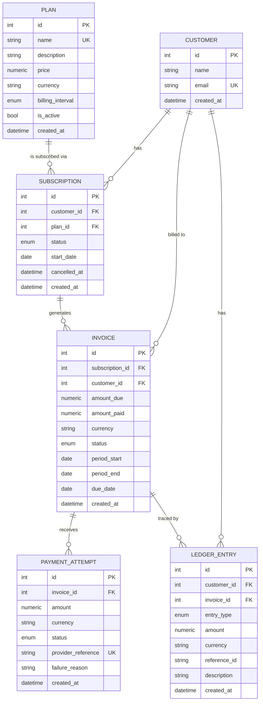
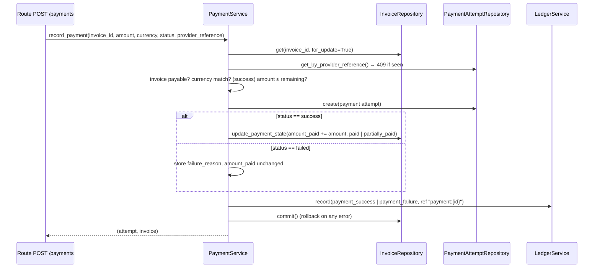
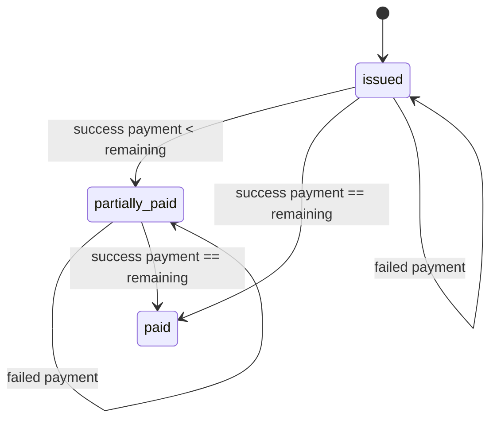

# SubLedger – Low-Level Design

## 1. Layered architecture

```
HTTP request
   │
   ▼
Routes (app/routes)            parse/validate via Pydantic schemas, call ONE service method, return response
   │
   ▼
Services (app/services)        business rules, use-case orchestration, transaction boundary (commit/rollback)
   │
   ▼
Repositories (app/repositories) queries and persistence only, no business decisions
   │
   ▼
Models (app/models) + DB (app/db.py)
```
Cross-cutting: `config.py` (settings), `exceptions.py` (domain errors → HTTP in `main.py`),
`dependencies.py` (wires repos into services per request).

## 2. ERD



### Fields/constraints added beyond the minimum, and why

| Addition | Reason |
|---|---|
| `Plan.billing_interval` | Needed to compute the default billing period (monthly/yearly). |
| `Plan.currency`, `Invoice.currency` | Money is meaningless without currency; invoice copies it as part of the price snapshot. |
| `Plan.name` unique | Prevents accidental duplicate plans. |
| `Subscription.cancelled_at` | Audit trail for cancellation. |
| `PaymentAttempt.provider_reference` unique | Idempotency key: the same provider event cannot be recorded twice. |
| `PaymentAttempt.failure_reason` | Required by the payment flow for failed attempts. |
| `LedgerEntry.description` | Human-readable context for each entry. |
| `Invoice` unique `(subscription_id, period_start, period_end)` | Prevents double-billing a period. |
| Partial unique index on `subscriptions(customer_id, plan_id) WHERE status='active'` | DB-level guarantee for the "one active subscription per plan" rule (race-safe). |
| Period/due fields are `DATE` (not `DATETIME`) | Billing periods are calendar concepts; avoids timezone ambiguity. |

## 3. Class responsibilities

### Services

| Service | Responsibility | Collaborators |
|---|---|---|
| `PlanService` | Create/update/activate plans; enforce price > 0 and unique name | PlanRepository |
| `CustomerService` | Create/get customers; enforce unique email | CustomerRepository |
| `SubscriptionService` | Create/cancel subscriptions; enforce active-plan and single-active-subscription rules | SubscriptionRepository, CustomerRepository, PlanRepository |
| `InvoiceService` | Generate invoices; price snapshot, period calculation, active-subscription check, duplicate-period guard | SubscriptionRepository, PlanRepository, InvoiceRepository, LedgerService |
| `PaymentService` | Record payment attempts; amount/currency validation, overpayment rule, invoice status transitions, idempotency | InvoiceRepository, PaymentAttemptRepository, LedgerService |
| `LedgerService` | Append ledger entries; owns the `reference_id` convention | LedgerRepository |

### Repositories

| Repository | Model | Methods |
|---|---|---|
| `PlanRepository` | Plan | `create`, `get`, `get_by_name`, `list(active_only)` |
| `CustomerRepository` | Customer | `create`, `get`, `get_by_email`, `list` |
| `SubscriptionRepository` | Subscription | `create`, `get`, `find_active(customer, plan)`, `list(customer_id)` |
| `InvoiceRepository` | Invoice | `create`, `get(for_update)`, `get_by_period`, `list(filters)`, `update_payment_state` |
| `PaymentAttemptRepository` | PaymentAttempt | `create`, `get_by_provider_reference`, `list_for_invoice` |
| `LedgerRepository` | LedgerEntry | `append`, `list(filters)` — **no update/delete** |

Repositories `flush` but never decide *whether* something is allowed; services own `commit`/`rollback`.

## 4. Business-rule ownership

| Rule | Owner (service) | Backstop |
|---|---|---|
| Plan price > 0 | `PlanService` | Pydantic `gt=0` on request schemas |
| Customer email unique | `CustomerService` | `UNIQUE(customers.email)`; emails lower-cased by schema |
| No subscription on inactive plan | `SubscriptionService` | – |
| No two active subs to same plan | `SubscriptionService` | Partial unique index |
| Invoice only for active subscription | `InvoiceService` | – |
| `amount_due` = plan price at generation | `InvoiceService` | Stored on invoice (snapshot) |
| No duplicate invoice per period | `InvoiceService` | `UNIQUE(subscription_id, period_start, period_end)` |
| Successful payment ≤ remaining amount | `PaymentService` | – |
| Fully paid → `paid`; partial → `partially_paid` | `PaymentService` | – |
| Failed payment never changes `amount_paid` | `PaymentService` | – |
| Provider reference not reusable | `PaymentService` | `UNIQUE(provider_reference)` |
| Ledger is append-only, traceable via `reference_id` | `LedgerService` + `LedgerRepository` | ORM `before_update`/`before_delete` listeners raise |

## 5. Design patterns used

- **Layered architecture / separation of concerns** – each layer has one reason to change.
- **Repository pattern** – isolates SQLAlchemy queries; services can be unit-tested with fakes.
- **Service layer (use-case/transaction script)** – business rules and the transaction boundary live in one place.
- **Dependency injection** – services receive repositories via constructors; FastAPI `Depends` wires them per request (`dependencies.py`).
- **DTO / schema pattern** – Pydantic schemas keep API contracts separate from ORM models.
- **Snapshot pattern** – invoice copies plan price/currency so history is unaffected by later price changes.
- **Append-only event log** – ledger entries are only ever inserted; corrections would be new entries.
- **Unit of work (lightweight)** – one SQLAlchemy session per request; invoice/payment + ledger commit together or roll back together.
- **Idempotency key** – `provider_reference` on payment attempts.

## 6. Core flows

### Invoice generation

```mermaid
sequenceDiagram
    participant R as Route POST /invoices/generate
    participant IS as InvoiceService
    participant SR as SubscriptionRepository
    participant PR as PlanRepository
    participant IR as InvoiceRepository
    participant LS as LedgerService
    R->>IS: generate_invoice(subscription_id, period?)
    IS->>SR: get(subscription_id)
    IS->>IS: 404 if missing, 422 if not active
    IS->>PR: get(plan_id)
    IS->>IS: period = given or today..+interval; amount_due = plan.price
    IS->>IR: get_by_period() → 409 if duplicate
    IS->>IR: create(invoice, status=issued)
    IS->>LS: record(invoice_created, ref "invoice:{id}")
    IS->>IR: commit()
    IS-->>R: invoice
```

### Payment recording



### Invoice status transitions



## 7. Testing strategy

25 API-level tests (`tests/`) against an in-memory SQLite DB, one fresh DB per test. They cover every
rule in section 4: price > 0, unique email, inactive plan, duplicate active subscription (and re-subscribe
after cancel), price snapshot, duplicate period, partial/full payment, overpayment, failed payment,
idempotency, currency mismatch, ledger traceability, and ledger immutability.
